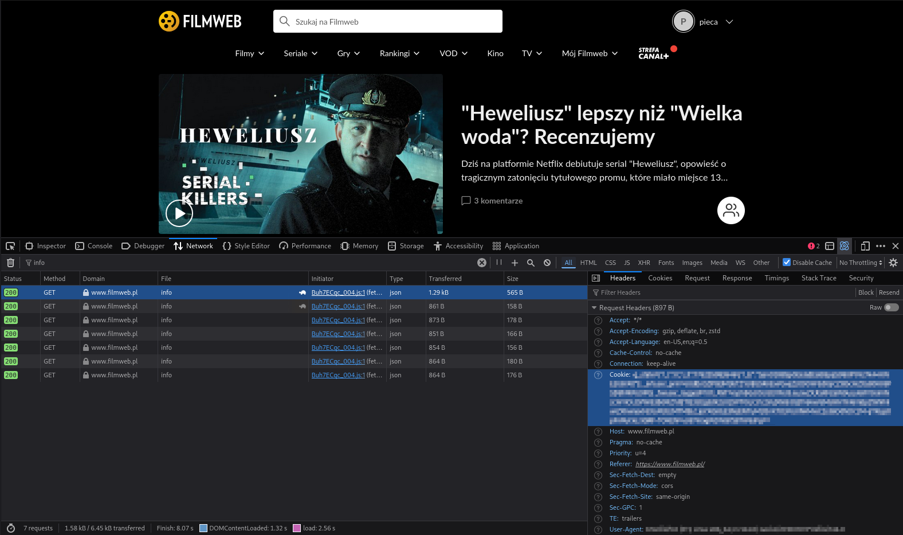

# filmweb-export

Eksport ocen filmów, seriali i gier z serwisu [Filmweb](https://www.filmweb.pl).

## Instalacja

Wymagania:

- [Python](https://www.python.org/).

Instalacja:

```
pip install filmweb
```

Albo:

```
pip install https://github.com/ppatrzyk/filmweb-export/archive/master.zip
```

### Gotowe binarki

Jeśli nie chcesz instalować Pythona, pobierz samodzielny plik wykonywalny z zakładki [Releases](https://github.com/ppatrzyk/filmweb-export/releases):

- `filmweb-windows-x64.exe` - Windows (x64),
- `filmweb-linux-x64` - Linux (x64); po pobraniu nadaj uprawnienia do uruchamiania: `chmod +x filmweb-linux-x64`.

Binarki działają tak samo jak polecenie `filmweb`, np. `./filmweb-linux-x64 <username> <cookie>`.

Własną binarkę możesz zbudować lokalnie ([PyInstaller](https://pyinstaller.org)):

```
pip install -r requirements.txt pyinstaller
pyinstaller packaging/filmweb.spec
```

Wynik znajdziesz w katalogu `dist/`. Binarki z każdego commita są też dostępne jako artefakty workflow *Build binaries* w zakładce Actions.

## Instrukcja

Istnieje możliwość eksportu własnych ocen lub ocen znajomych - proszę podać nazwę użytkownika jako `username`. Do dostępu jest potrzebne zalogowanie się na portal i podanie do skryptu wartości `cookie` dla strony filmweb. Podstawowe użycie:

```
filmweb <username> <cookie>
```

### Ograniczanie obciążenia serwera

Domyślnie program używa tylu równoległych procesów, ile jest dostępnych CPU. Można to ograniczyć opcją `--threads` (wartość większa od domyślnej jest ucinana do domyślnej):

```
filmweb --threads 2 <username> <cookie>
```

Domyślnie pobierane są wszystkie strony z listą ocen (po 100 tytułów na stronę, osobno dla każdego typu). Opcja `--pages` pozwala pobrać tylko wybrany zakres:

```
filmweb --pages 2-5 <username> <cookie>   # strony 2-5
filmweb --pages 3 <username> <cookie>     # tylko strona 3
filmweb --pages 4- <username> <cookie>    # od strony 4 do końca
```

### Skąd wziąć cookie?

#### Użycie dodatku [cookie-editor](https://cookie-editor.com/)

1. Mając zainstalowany dodatek wejdź na stronę [filmweb.pl](https://www.filmweb.pl/) i zaloguj się.
2. Kliknij na dodatku 
    

3. Następnie wybierz "Export" i wybierz "Header String" - wtedy masz w schowku gotowca do wklejenia.

#### Ręczne pobranie ciasteczek

1. Otwórz *Network Monitor* w przeglądarce (`Ctrl+Shift+E` w Firefoxie),
2. Zaloguj się i wejdź na filmweb. Wpisz `info` do filtra w *Network Monitor* i zaznacz pierwszy wynik,
3. Wejdź w zakładkę *Headers* > *Request Headers*,
4. Skopiuj wartość *Cookie* i podaj ją jako argument do skryptu.



### Przykład

```
$ filmweb -f csv -f json pieca "didomi_token=(...)=="
INFO:root:Checking args...
INFO:root:Fetching list of rated titles [1/4]...
INFO:root:Fetching list of movie ratings...
100%|█████████████████████████████████████████████████████████████████████████████████████████████████████████████████████████████████████████████████| 10/10 [00:00<00:00, 43.70it/s]
INFO:root:Fetching list of tv_show ratings...
100%|███████████████████████████████████████████████████████████████████████████████████████████████████████████████████████████████████████████████████| 1/1 [00:00<00:00, 10.30it/s]
INFO:root:Skipping game, no ratings found
INFO:root:User pieca has 955 rated titles...
INFO:root:Fetching info about titles [2/4]...
100%|███████████████████████████████████████████████████████████████████████████████████████████████████████████████████████████████████████████████| 955/955 [01:02<00:00, 15.21it/s]
INFO:root:Fetching global rating for titles [3/4]...
100%|███████████████████████████████████████████████████████████████████████████████████████████████████████████████████████████████████████████████| 955/955 [01:15<00:00, 12.72it/s]
INFO:root:Writing data [4/4]...
INFO:root:pieca_20260604.json written!
INFO:root:pieca_20260604.csv written!
$ cat pieca_20260604.json | jq .[0]
{
  "timestamp": 1579354599456,
  "favorite": null,
  "user_rating": 5,
  "global_rating": 6.03865,
  "global_rating_count": 414,
  "original_title": "Ejdeha Vared Mishavad!",
  "pl_title": "Wejście smoka!",
  "year": 2016,
  "movie_id": "757318",
  "title_type": "movie",
  "title_sub_type": "film_cinema",
  "url": "https://www.filmweb.pl/film/Wej%C5%9Bcie+smoka%21-2016-757318",
  "date": "2020-01-18"
}
$ duckdb -box -c "SELECT * FROM read_csv_auto('pieca_20260604.csv') ORDER BY RANDOM() LIMIT 3;"
┌───────────────┬──────────┬─────────────┬───────────────┬─────────────────────┬─────────────────┬─────────────────┬──────┬──────────┬────────────┬────────────────┬────────────────────────────────────────────────────────────────────┬────────────┐
│   timestamp   │ favorite │ user_rating │ global_rating │ global_rating_count │ original_title  │    pl_title     │ year │ movie_id │ title_type │ title_sub_type │                                url                                 │    date    │
├───────────────┼──────────┼─────────────┼───────────────┼─────────────────────┼─────────────────┼─────────────────┼──────┼──────────┼────────────┼────────────────┼────────────────────────────────────────────────────────────────────┼────────────┤
│ 1552236606975 │ NULL     │ 7           │ 6.60002       │ 25576               │ Force Majeure   │ Turysta         │ 2014 │ 709434   │ movie      │ film_cinema    │ https://www.filmweb.pl/film/Turysta-2014-709434                    │ 2019-03-10 │
│ 1638616857444 │ NULL     │ 5           │ 7.27418       │ 60056               │ Pogoda na jutro │ Pogoda na jutro │ 2003 │ 39495    │ movie      │ film_cinema    │ https://www.filmweb.pl/film/Pogoda+na+jutro-2003-39495             │ 2021-12-04 │
│ 1638614791800 │ NULL     │ 6           │ 7.69933       │ 51552               │ Żółty szalik    │ Żółty szalik    │ 2000 │ 32453    │ movie      │ film_tv        │ https://www.filmweb.pl/film/%C5%BB%C3%B3%C5%82ty+szalik-2000-32453 │ 2021-12-04 │
└───────────────┴──────────┴─────────────┴───────────────┴─────────────────────┴─────────────────┴─────────────────┴──────┴──────────┴────────────┴────────────────┴────────────────────────────────────────────────────────────────────┴────────────┘

```

### Wszystkie opcje

```
$ filmweb -h
filmweb

Usage:
    filmweb [--format=<fileformat>]... [--type=<titletype>]... [--debug] <username> <cookie>

Options:
    -h --help                     Show this screen
    -f --format=<fileformat>      Output file format: json (default), csv, letterboxd
    -t --type=<titletype>         Title type: movie, tv_show, game (all by default)
    -d --debug                    Debug prints
```

## Dostępne dane:

Kolumna | Opis
--- | ---
year | _premiera_
global\_rating\_count | _ilość ocen filmu_
global\_rating | _ocena filmweb_
timestamp | _[czas oceny (unix)](https://pl.wikipedia.org/wiki/Czas_uniksowy)_
date | _data oceny_ (yyyy-mm-dd)
user\_rating | _ocena użytkownika_
favorite | _dodany do ulubionych_
original\_title | _tytuł oryginalny_
pl\_title | _tytuł polski_
movie\_id | _id filmu_ (filmweb)
title\_type | _typ tytułu_ (movie, tv\_show, game)
title\_sub\_type | _podtyp tytułu_ (np. serial\_tv, mini\_serial)
url | _strona filmu_
